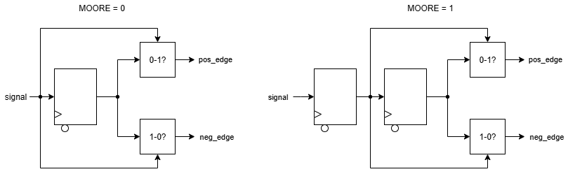
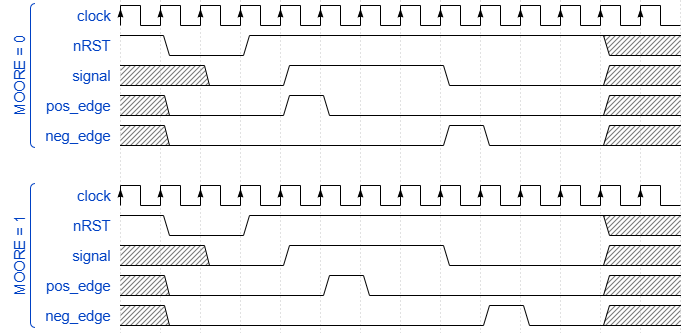

# Edge Detector
Detects 0-1 or 1-0 transitions in an input signal between two cycles, with options for combinational (Mealy) and sequential (Moore) output generation.

## RTL Diagram

The diagram shows both configurations side-by-side. In the Mealy variant
(`MOORE = 0`, left), the input `signal` feeds a single DFF, and the current
input is compared against the registered value by two combinational
comparators that produce `pos_edge` (0-to-1) and `neg_edge` (1-to-0)
directly. In the Moore variant (`MOORE = 1`, right), `signal` passes
through two chained DFFs, and the comparators operate on the two registered
values, so the outputs are themselves registered and lag the input by an
extra cycle.

## Sample Waveform

The waveform shows both variants reacting to the same `signal` input transitions.
In the Mealy configuration (top), `pos_edge` and `neg_edge` pulse high in
the same cycle as the corresponding 0-to-1 and 1-to-0 transitions on
`signal`. In the Moore configuration (bottom), the same pulses appear one
cycle later, reflecting the extra register stage on the output path.

## I/O
| Port Name | Direction | Type | Description |
|:---------:|:---------:|:----:|:-----------|
| `CLK` | `input` | `logic` | Clock |
| `nRST` | `input` | `logic` | Active-low asynchronous reset |
| `signal` | `input` | `logic [WIDTH-1 : 0]` | Input signal to monitor for transitions |
| `pos_edge` | `output` | `logic [WIDTH-1 : 0]` | High if a 0-1 transition detected on the corresponding input signal |
| `neg_edge` | `output` | `logic [WIDTH-1 : 0]` | High if a 1-0 transition detected on the corresponding input signal |

## Function
This module detects transitions in the input signal(s) by latching their value in a DFF each cycle (two chained DFFs for Moore mode). If the Mealy machine type is selected, the current input is compared to the latched value; if they are not the same, either the corresponding `pos_edge` or `neg_edge` value is set. If the Moore machine type is selected, the last two latched values are compared instead. Note that if the Moore machine type is chosen, the output is driven by a register, and the edge detection is delayed by one clock cycle.

## Parameters
| Parameter     | Type | Description | Default Value | Valid Range |
|:---------------:|:------:|:-------------|:---------------:|:-------------:|
| `WIDTH` | `int` | Bit-width of the input signal to monitor | 1 | >= 1 |
| `RESET` | `logic` | Reset value of the signal being tracked | 0 | 0, 1 |
| `MOORE` | `logic` | Determines the Machine type. `MOORE = 0` indicates Mealy, and `MOORE = 1` indicates Moore | `0` | `0`, `1` |
